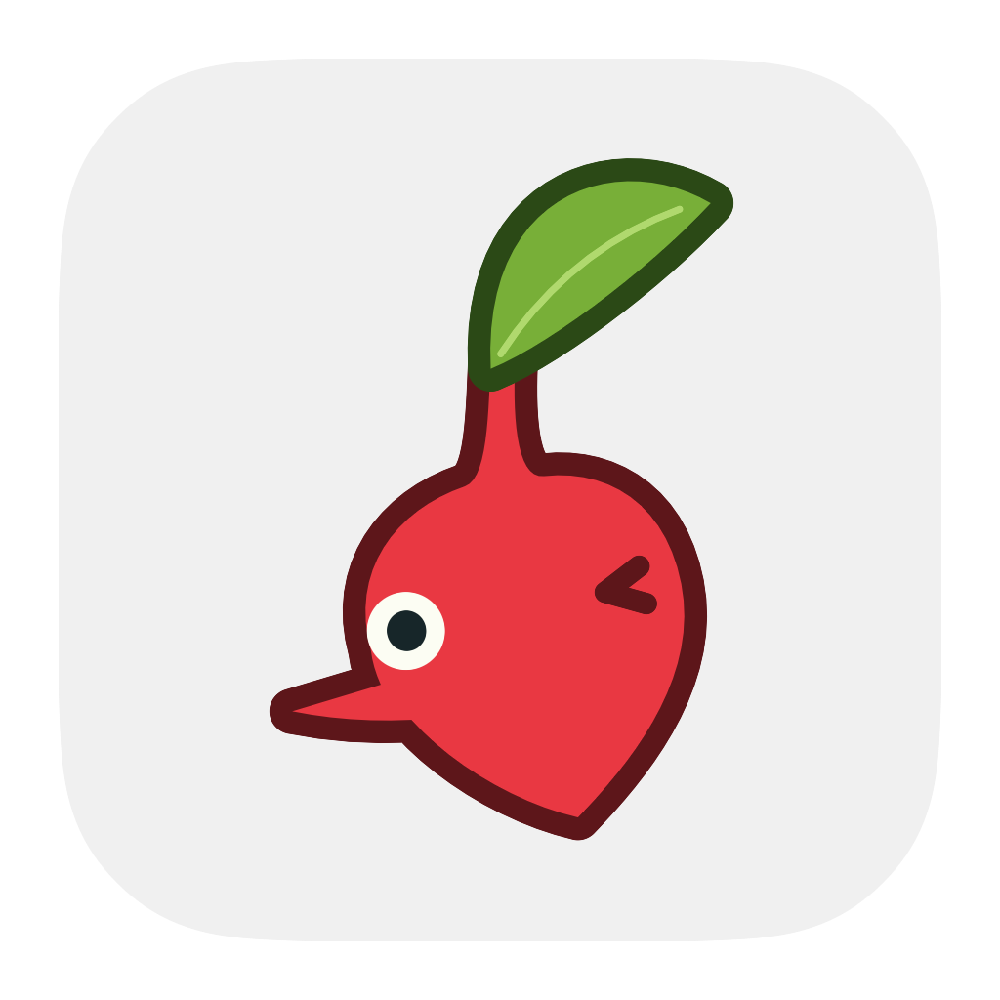
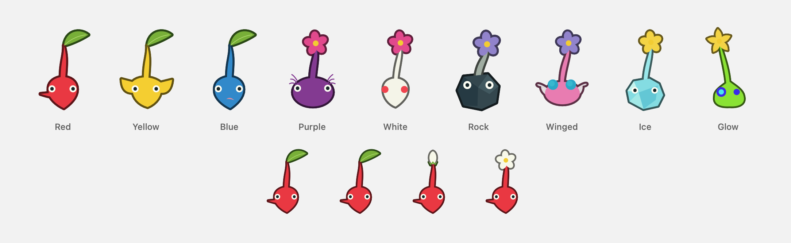

<p align="center">
  
</p>
<h1 align="center">Pikminions</h1>
<p align="center">Your agents, as little desktop companions.</p>
<p align="center">
  
  
  
</p>

Pikminions gives T3 Code conversations recognizable Pikmin heads. Grab one, let it dangle, toss it into a liquid black island, or pull its smaller head back onto your desktop. Click it to read recent output and respond.

<p align="center"></p>

## Install

Download the latest [release](https://github.com/upsidedly/pikminions/releases/latest), open the `.dmg`, and drag **Pikminions** into **Applications**. These builds are for Apple silicon Macs. Quit an older Pikminions before replacing it.

The app is locally signed and is not notarized. macOS may require first-launch approval in **System Settings → Privacy & Security**.

## Use

1. Open **Connections** and connect to the local T3 environment. Replies, question answers, and thread controls are ready as part of that connection.
2. Choose the projects and heads to keep visible. Each head keeps the same conversation identity; its local nickname, species, growth, position, and docking preference survive restart.
3. Click a head for its conversation bubble. Read live output, reply, or answer a pending question directly above it.

**Move them.** Heads look toward a nearby cursor, swing around the grabbed point, and settle when held still. A release can glide; stronger gravity and fixed positions are optional. Right-click **Dismiss** to send a head spinning along an arc into the island. The island becomes a dedicated magnetic drop target during the gesture. Pull a compact head out again, or choose **To desktop**.

**Size them.** Right-click a desktop head → **Size → Small, Medium, Large or XL**. Medium is the original size. Each Pikmin remembers its own choice, including after docking and pulling it back out. Resizing keeps the head centered and on screen; island icons keep their compact size.

**Talk through them.** Vocal mode streams new agent messages in a small speech box with a tail toward the head. When speech finishes, Reply reveals a small editor; questions show their actual answer controls immediately. Completed unattended speech closes after a reading interval; hovering, replying or answering keeps it available. Open conversation switches to the full Markdown history without losing the draft. Its corner grip resizes by dragging or grows the window with a click. Full conversation bubbles follow new output until you scroll back; Latest resumes following. Pin a full conversation to keep it open across outside clicks. Permission requests open T3 for review.

Talk follows partial text supplied by T3, including Codex turn-item updates, rather than waiting for the completed message. New Markdown text fades in without replaying existing text; Reply appears after completion. Dismissing a message keeps that same message closed as more chunks arrive.

The compact island shows only agents that are working, starting, queued or awaiting input/approval. Completed heads leave the bar on the next state refresh; a running sibling in the same project does not keep them there. Retained docked/pinned heads remain available in the expanded roster. New runs take priority over older active runs, while ordinary streamed text keeps heads in place.

**Vocal mode.** Right-click a head and toggle **Vocal mode**. Its current question or latest output appears in a compact speech bubble; future incoming output streams there automatically. Reply in the same bubble or answer its native question choices. **Conversation** opens the fuller history. Vocal mode is a per-head preference and uses visible speech, with no microphone or system voice.

Automatic bubbles appear without activating the app. Clicking away dismisses an unpinned one until the next new message; repeated chunks do not reopen it. At most three automatic bubbles share space, and they do not displace pinned/manual bubbles or an in-progress draft. Completed historical output does not replay on launch. Click a head or interact with its bubble to call it to attention: bobbing and hopping stop while you talk, and its request mark remains visible. It moves slightly toward the bubble and looks at it. Bubble placement reserves the entire head and stem, switches sides or reduces height near screen edges, and restores the preferred size when there is room. A head occasionally chooses a random look-around, double blink, stretch, leaf wiggle or sleepy nod while idle. Dismissing, docking or hiding it closes its bubble, even if pinned, and keeps its draft in memory.

**Manage the conversation.** Rename the Pikmin locally, retry the last instruction, fork with history, create a fresh conversation, or stop a run. Retry and fresh/fork are separate actions. Failed submissions retain their drafts and command identities.

**Collaborate.** Bring two heads together or choose **Collaborate…**, select a partner, and submit an instruction. Pikminions asks the selected T3 thread to coordinate with the other existing thread. The agent performs the exchange through T3; submitting the instruction does not mean the collaboration is finished.

**Custom looks.** Choose **New look…** in Squad or Appearance, or right-click a head → **Pikmin → Customize…**. Name a reusable look, choose one of the nine head shapes, set body, stem, flower, leaf and eye colors, adjust stem length/curve, and choose a top. Native color wells and hex values are available. Saved looks appear in the gallery; right-click one to edit or duplicate it. Assignments keep the same agent/thread identity and carry through desktop, bubbles and both island modes.

**Celebrate.** A new completed latest assistant message containing literal `ACCEPT` triggers a brief celebration on the desktop or in the island. Historical output and repeated message IDs do not replay it.

## The island

**Desktop**, **Island**, and **Both** modes control where heads live. The island stays black to join the Mac’s camera cutout, grows wings for additional heads, and provides overflow selection. Hover gives a small invitation; click opens the conversation. It stays open for keyboard replies until an outside click or Escape, unless pinned. Dragging a head toward it uses the receptive drop surface.

Hover a desktop head and press **↑** to dismiss it; hover an island head and press **↓** to bring it out. These keys are registered only over eligible heads and released during menus.

The expanded view keeps one reply action visible, with other controls in the ellipsis/context menu. Output supports Markdown headings, emphasis, links, lists, quotes, fenced code and tables. Incoming text fades in briefly while existing text stays steady; longer output scrolls and can pause following when you read back. Pending questions replace old output and use content-driven height. Reduce Motion removes the fades and physical effects.

Pikminions embeds [Antille](https://github.com/Upsidedly/antille). To share the standalone host, run Antille, choose **Pair with Antille**, approve Pikminions in Antille’s **Sources** tab, then pair again. Pikminions uses the shared host only after access succeeds; an unpaired, unavailable or rejecting host falls back to the embedded island so docking keeps working.

## Build

Requires macOS 14+ and a Swift 6 toolchain. Swift Package Manager fetches [Antille](https://github.com/Upsidedly/antille) automatically.

```sh
python3 scripts/build.py --release
open dist/Pikminions.app
```

The script runs focused checks, exports the artwork, generates the icon, and creates a locally signed development bundle. Omit `--release` for a debug build. To develop against a local Antille checkout, set `ANTILLE_PACKAGE_PATH` to that directory before running a build command.

To open the installed app automatically, add `/Applications/Pikminions.app` in **System Settings → General → Login Items & Extensions → Open at Login**. Building the app does not change login-item settings.

For deterministic sample agents:

```sh
python3 scripts/build.py --fixture
open dist/PikminionsFixture.app
```

The fixture has separate preferences and sprites, RAM-only credentials, and an in-memory source. Live connections, notifications, sounds, haptics, and external navigation are disabled. Pair it with AntilleFixture to test the shared host.

## Connections and privacy

- **T3:** read-scoped access polls metadata every four seconds. Bounded, cached reads obtain the latest output for visible heads; focused conversations and visible heads in Vocal mode stream over local WebSockets. Connecting prepares scoped command access automatically; replies and thread operations still require your explicit submission. Disconnect revokes app-owned sessions.
- **Codex:** observes an existing shared app-server connection when available. Otherwise, local history is labeled **recorded** and hidden by default. Recorded sessions cannot receive replies. Live standalone Codex controls remain unverified on this Mac.
- **Storage:** preferences, nicknames, custom looks/assignments, positions, and success-event IDs are saved locally. Conversation text and drafts stay in memory. Submitted replies go through T3 and its configured provider.
- **Credentials:** normal access uses Keychain only when interaction can be suppressed. It fails closed if a security prompt would be needed, with no plaintext fallback. The app never approves a security prompt automatically.
- **Local rebuilds:** credentials belong to the installed build's signing identity. Relaunching that build restores access; rebuilding locally requires reconnecting T3 and pairing Antille again. Older Keychain permissions stay intact.
- **Alerts:** notifications and synthesized chirps are opt-in and obey macOS notification settings. Historical states do not replay alerts.

The characters are derivative fan art based on Nintendo’s Pikmin. The app uses authored vector paths and synthesized audio; no game sprites or game audio are bundled. See [provenance](PROVENANCE.md).

## Development

```sh
swift build
.build/debug/PikminionsApp --check --fixture
```

Native sample fixtures in `Tests/NativeFixtures` exercise menus, panel sizes, speech and conversation rendering without connecting to real threads. Development-Mac checks do not establish every display, oldest supported runtime or physical pointer/keyboard combination. Local work logs and investigation captures are excluded from this repository.

## License and contact

Original code and contributions are available under the [Mozilla Public License 2.0](LICENSE). Copyright © 2026 Matthew Williams.

Pikminions is an independent, unofficial fan project and is not affiliated with or endorsed by Nintendo. Pikmin names and character designs belong to Nintendo; the code license does not grant rights to Nintendo’s characters, names or trademarks. See [provenance](PROVENANCE.md).

For questions, rights concerns or takedown requests, contact **Matthew Williams** at **[matthewlloydw@gmail.com](mailto:matthewlloydw@gmail.com)**.
